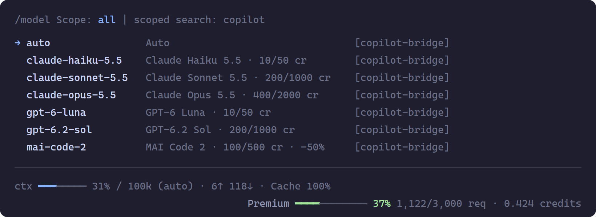

# pi-copilot-bridge



Use your GitHub Copilot subscription in the [Pi coding agent](https://github.com/earendil-works/pi)
through the official `@microsoft/copilot-sdk`. Models appear in Pi as `copilot-bridge/<model>`.
Log in once from Pi (`/login` → "GitHub Copilot (SDK)") or with the Copilot CLI.

See [ARCHITECTURE.md](ARCHITECTURE.md) for how Pi turns map to Copilot sessions.

## Why

Pi's built-in `github-copilot` provider identifies itself as VS Code Copilot Chat. This bridge uses
the official SDK instead, so requests are genuine Copilot runtime traffic under your own login.
Pi stays in control: Copilot sees only Pi's tools, Pi executes them (your tool guards apply), and all
permission requests from the runtime are rejected.

- One premium request per prompt, even when the model calls many tools in between.
- Prices per model in the picker (AI credits per 1M tokens), e.g. `Claude Haiku 5.5 · 10/50 cr`.
- Copilot quota and session credits in the footer with [pi-limits](https://github.com/Gwengal/pi-limits).
- Pi's thinking level maps to Copilot's reasoning effort where the model supports it.

## Install

```sh
pi install npm:pi-copilot-bridge
```

In Pi: `/login` → "GitHub Copilot (SDK)" (device code in the browser). Alternatively log in with the
Copilot CLI: `npx @github/copilot`, run `/login` inside, then `/exit`. Both share the same login.

The Copilot runtime picks the account: a Copilot login (Pi `/login` or the Copilot CLI), the GitHub
CLI login (`gh`), or a token in `COPILOT_GITHUB_TOKEN`, `GH_TOKEN` or `GITHUB_TOKEN`. A Copilot login
takes precedence over the GitHub CLI login. Pi always shows the active account once per session (e.g.
`Copilot account: octocat (GitHub CLI)`), and the quota footer names it.

Then pick a model with `/model`, for example `copilot-bridge/auto` or `copilot-bridge/claude-haiku-5.5`.
Organization accounts need the "Copilot CLI" policy enabled by an admin. On Linux servers without a
keyring, set `COPILOT_GITHUB_TOKEN`.

Set `PI_COPILOT_BRIDGE_DEBUG=1` to log each new Copilot session (without prompt content) to stderr.

## Limitations

- **Images in tool results** reach the model only if it supports vision, and only within its limits
  (image types, size, images per request). Otherwise the model sees a note such as `[image omitted]`.
- **Images in earlier messages** are not replayed when the bridge has to rebuild the Copilot session
  (after a fork, resume or edited history); only the images of the newest prompt are attached.
- **Context window** is the prompt budget of the model's default price tier, not its technical
  maximum, so Pi compacts before Copilot would bill long-context prices.
- **One request per Pi session at a time.** A concurrent second request fails instead of
  interrupting the first.
- **Prompt-cache warming** is not supported; Pi's warming requests are declined without cost.
